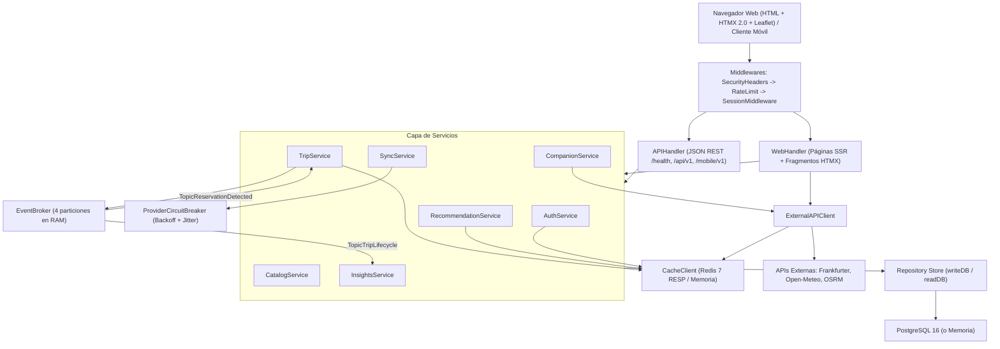

# Documentación Técnica — Trotamundos V2 (`TrotamundosAplicacionV2`)

Plataforma web comercial de reservas multimodales, planificación inteligente de itinerarios, sincronización de confirmaciones por correo y código PNR, asistente interactivo en destino, motor de recomendaciones y analítica de tendencias de la comunidad.

---

## Tabla de Contenidos

1. [Descripción General y Propósito](#1-descripción-general-y-propósito)
2. [Stack Tecnológico](#2-stack-tecnológico)
3. [Estructura de Directorios y Módulos](#3-estructura-de-directorios-y-módulos)
4. [Arquitectura Interna y Flujos Principales](#4-arquitectura-interna-y-flujos-principales)
5. [Modelo de Datos (PostgreSQL)](#5-modelo-de-datos-postgresql)
6. [Rutas Web, Endpoints HTMX y API REST](#6-rutas-web-endpoints-htmx-y-api-rest)
7. [Configuración, Operación y Pruebas](#7-configuración-operación-y-pruebas)
8. [Consideraciones de Arquitectura y Alcance Local](#8-consideraciones-de-arquitectura-y-alcance-local)

---

## 1. Descripción General y Propósito

**Trotamundos V2** centraliza el ciclo completo de un viaje multimodal (vuelos, alojamientos, trenes de alta velocidad, autobuses de larga distancia y alquiler de autos) en una única experiencia web orientada al viajero real.

### Principios de Producto y UX

* **Identidad visual luminosa:** Estética inspirada en plataformas comerciales modernas de turismo (fondo cálido `#FAF8F7`, tarjetas editoriales en blanco, tipografía *Plus Jakarta Sans* + *Inter* + *JetBrains Mono* y color primario Rojo Trotamundos `#E11D48` / `#FF385C`).
* **Cuentas nuevas limpias:** Al registrarse en `/register`, cada usuario comienza con **0 viajes** y **bandeja de correo vacía**, más una lista blanca predeterminada de 16 dominios confiables de aerolíneas, hoteles, trenes, buses y rentadoras (`EnsureDefaultSenderRules`).
* **Onboarding guiado:** Tanto tras el registro como tras iniciar sesión, el sistema redirige a `/welcome` (*Guía de uso*), donde se explica cada sección y cómo configurar moneda y agencia de asistencia.
* **Catálogo y precios dinámicos:** Todos los precios del catálogo (almacenados en su moneda de origen `USD` o `EUR`) se convierten automáticamente en el servidor a la moneda configurada por el usuario (`USD`, `EUR`, `ARS`, `JPY`, `BRL`). Al cambiar de moneda o agencia en la barra superior, el servidor responde con `HX-Refresh: true` para recargar toda la vista automáticamente.
* **Protección contra sobrescrituras:** Las ediciones manuales realizadas por el usuario sobre una reserva quedan registradas campo por campo (`manually_modified`, `modified_fields`) para impedir que sincronizaciones externas posteriores las sobrescriban.
* **Privacidad desde el diseño:** La analítica comunitaria anonimiza los identificadores de usuario mediante un HMAC-SHA256 salteado irreversible antes de persistir hechos en `analytics_facts`.

---

## 2. Stack Tecnológico

| Capa | Tecnología / Librería | Uso Principal |
| :--- | :--- | :--- |
| **Lenguaje / Runtime** | Go `1.25.0` (`net/http`, `html/template`) | Servidor HTTP monolítico modular con enrutamiento nativo Go 1.22+ y renderizado SSR |
| **Base de Datos** | PostgreSQL 16 (`postgres:16-alpine`) + `github.com/jackc/pgx/v5/stdlib` | Persistencia transaccional ACID, migraciones automáticas y fallback automático a memoria si `DATABASE_URL` no está definido |
| **Caché Distribuida** | Redis 7 (`redis:7-alpine`) vía cliente TCP RESP propio | Caché de consultas de viajes, recomendaciones, revocación de sesiones y respuestas de APIs externas (con fallback en memoria) |
| **Frontend Reactivo** | **HTMX 2.0.4** + **Tailwind CSS** (CDN) + JS Vanilla (`app.js`) | Actualizaciones parciales sin recarga completa, modales, notificaciones *toast* y formulario dinámico de segmentos |
| **Mapas Interactivos** | **Leaflet 1.9.4** + **OpenStreetMap** + **OSRM** | Visualización de ruta real aeropuerto/estación ↔ hotel en `/companion` |
| **APIs Externas** | **Frankfurter API**, **Open-Meteo API**, **OSRM** | Tasas de cambio reales, clima actual y geometría vial con timeout (`<= 1.8s`), caché de 10 min y fallback determinista local |
| **Contenedores y Operación** | Docker (build multi-stage en `alpine:3.20`) + Docker Compose | Orquestación de `db`, `cache` y `app`, junto con scripts `iniciar.sh` y `cerrar.sh` |

---

## 3. Estructura de Directorios y Módulos

```text
TrotamundosAplicacionV2/
├── AGENTS.md                         # Reglas de producto y arquitectura para desarrollo
├── README.md                         # Guía rápida de características y comandos
├── documentacion.md                  # Este documento técnico
├── Dockerfile                        # Imagen multi-stage (golang:alpine -> alpine:3.20)
├── docker-compose.yml                # Servicios db (PostgreSQL 16), cache (Redis 7) y app
├── go.mod / go.sum                   # Dependencias Go (módulo trotamundos, driver pgx/v5)
├── iniciar.sh                        # Arranque seguro + restauración automática de respaldo
├── cerrar.sh                         # Respaldo SQL portátil + apagado limpio sin borrar volúmenes
├── backups/
│   └── trotamundos_backup.sql        # Respaldo SQL generado por pg_dump desde cerrar.sh
├── cmd/
│   └── server/
│       └── main.go                   # Punto de entrada, inyección de dependencias y graceful shutdown
├── internal/
│   ├── config/
│   │   └── config.go                 # Carga de variables de entorno y valores por defecto
│   ├── domain/
│   │   ├── errors.go                 # Errores de dominio tipados (ErrForbidden, ErrNotFound, etc.)
│   │   └── models.go                 # Entidades, métodos de ciclo de vida, ACL y helpers de vista
│   ├── handler/
│   │   ├── middleware.go             # SecurityHeaders, RateLimit (429) y SessionMiddleware
│   │   ├── render.go                 # Motor html/template, FuncMap (formatMoney, dict, etc.) y toasts
│   │   ├── web_handler.go            # Controladores SSR, HTMX y conversión dinámica de moneda
│   │   ├── api_handler.go            # Endpoints JSON REST (/health, /api/v1/*, /mobile/v1/*)
│   │   └── server_test.go            # Suite de tests E2E, HTMX y modal de reserva
│   ├── platform/
│   │   ├── broker.go                 # EventBroker en memoria con 4 particiones y cola de 256 eventos
│   │   ├── cache.go                  # CacheClient Redis RESP sobre TCP con fallback en memoria
│   │   ├── external_apis.go          # Cliente Frankfurter, Open-Meteo y OSRM con fast-path offline
│   │   ├── resilience.go             # ProviderCircuitBreaker (HEALTHY / DEGRADED / RECOVERING)
│   │   └── security.go               # PBKDF2-HMAC-SHA256, TokenService, RateLimiter y seudonimización
│   ├── repository/
│   │   ├── store.go                  # Store unificado (writeDB/readDB PostgreSQL + memoria) y DDL
│   │   └── seed.go                   # 4 agencias, 2 usuarios muestra, 6 paquetes, 18 ofertas y 12 facts
│   └── service/
│       ├── auth_service.go           # Registro, login, logout con revocación y cálculo de iniciales
│       ├── catalog_service.go        # Reserva de paquetes, ofertas (trip existente/NEW/AUTO) y envío a inbox
│       ├── trip_service.go           # CRUD viajes/reservas, agrupación, archivado, ACL, share y soporte
│       ├── sync_service.go           # Importación PNR, escaneo de correos, inbox sync y lista blanca
│       ├── companion_service.go      # Rutas en destino, zona horaria, clima, moneda y token de ruta
│       ├── recommendation_service.go # Motor Strategy (CollaborativeStrategy / TrendingStrategy) + caché
│       └── insights_service.go       # Consumidor de trip.lifecycle, tendencias y puntualidad
└── web/
    ├── static/
    │   ├── css/app.css               # Variables CSS, timeline multimodal, indicadores HTMX
    │   └── js/app.js                 # Mapa Leaflet, modal close, presets de correo y dropdown explorar
    └── templates/
        ├── layouts/
        │   └── base.html             # Layout principal, navbar, selector moneda/agencia, modales y toasts
        ├── pages/                    # 9 páginas completas
        │   ├── login.html
        │   ├── register.html
        │   ├── welcome.html
        │   ├── dashboard.html
        │   ├── explore.html
        │   ├── explore_packages.html
        │   ├── inbox.html
        │   ├── companion.html
        │   └── trends.html
        └── partials/                 # 11 fragmentos HTMX reutilizables
            ├── book_offer_modal.html
            ├── catalog_offers.html
            ├── companion_route.html
            ├── inbox_panel.html
            ├── insights_panel.html
            ├── recommendations.html
            ├── reservation_item.html
            ├── reservation_modal.html
            ├── toast.html
            ├── trip_card.html
            └── trip_list.html
```

---

## 4. Arquitectura Interna y Flujos Principales

### Diagrama de Capas y Comunicación



### Detalle de Subsistemas

#### A. Autenticación, Seguridad y Control de Acceso (`security.go`, `middleware.go`, `auth_service.go`)
* **Contraseñas:** Se hashean con **PBKDF2-HMAC-SHA256** (15.000 iteraciones, sal criptográfica de 16 bytes, clave derivada de 32 bytes; comparación en tiempo constante `subtle.ConstantTimeCompare`).
* **Sesiones y Tokens:** `TokenService` emite tokens firmados con **HMAC-SHA256** que contienen `sub` (`UserID`), `role`, `iat` y `exp` (TTL por defecto de 24 horas). Se aceptan tanto por cookie `HttpOnly` (`trotamundos_session`, `SameSite=Lax`) como por cabecera `Authorization: Bearer <token>`.
* **Revocación:** Al ejecutar `POST /logout`, el token se agrega a una lista de revocación en memoria y en Redis (`revoked:<token>`).
* **Limitación de tasa (`RateLimiter`):** Ventana deslizante por minuto por dirección IP (`RATE_LIMIT_RPM`, 300 en Docker, 240 por defecto en código); omite `/health` y `/static/`. Si se excede, responde `HTTP 429 Too Many Requests` con cabecera `Retry-After: 60`.
* **Cabeceras de seguridad:** `X-Content-Type-Options: nosniff`, `X-Frame-Options: SAMEORIGIN`, `Referrer-Policy: strict-origin-when-cross-origin`.
* **Autorización por viaje y auditoría (`TripService.GetTripForUser`):** Verifica que el usuario sea propietario (`OwnerID`) o invitado (`SharedWithUserIDs` / `SharedWithEmails`). Si no tiene acceso, registra un evento en `audit_logs` con `Outcome: "DENIED"`, acción `ACCESS_TRIP` e IP del cliente, y retorna `domain.ErrForbidden` (`HTTP 403`).

#### B. Catálogo Precargado y Conversión Dinámica de Moneda (`seed.go`, `catalog_service.go`, `web_handler.go`)
* **Paquetes completos (`/explore/packages`):** 6 paquetes multimodales precargados (*Japón Imperial*, *Alta Velocidad Ibérica*, *Patagonia Andina*, *Roma Clásica*, *Cusco & Machu Picchu*, *París & Londres*), cada uno con **3 fechas de salida** (`AvailableDates`) y segmentos predefinidos (vuelo + hotel + tren/bus/auto). Al reservar un paquete, se crea el viaje y se envían los comprobantes ya marcados como `IMPORTED` a la bandeja `/inbox`.
* **Buscador de ofertas individuales (`/explore`):** 18 tramos individuales (`6 vuelos`, `4 hoteles`, `4 trenes`, `2 alquileres de auto`, `2 autobuses`), filtrables en vivo por texto (`q`) y tipo (`type`: `ALL`, `FLIGHT`, `HOTEL`, `TRAIN`, `BUS`, `RENTAL`). Los resultados se renderizan inmediatamente debajo del buscador en `#catalog-offers-grid`.
* **Modal de selección de viaje destino (`book_offer_modal.html`):** Al pulsar *"Agregar a mis viajes"* en una oferta individual, se abre un modal (`GET /partials/catalog/offers/{id}/book-modal`) que permite al usuario elegir entre:
  1. Agregar el segmento a uno de sus **viajes activos existentes** (por `tripID`).
  2. **Crear un viaje nuevo** con título personalizado (`targetTripId = "NEW"`).
  3. **Agrupación automática por destino** (`targetTripId = "AUTO"`).
* **Conversión dinámica de moneda:** Cada oferta o paquete se almacena en el catálogo con su moneda base (`USD` o `EUR`). Antes de renderizar páginas, parciales o modales, `WebHandler` ejecuta `convertAmount(amount, fromCurrency, user.HomeCurrency)` apoyándose en `ExternalAPIClient.GetExchangeRate`.

#### C. Gestión de Viajes e Itinerarios (`/`, `/trips`, `trip_service.go`, `models.go`)
* **Línea de tiempo multimodal:** Cada viaje agrupa sus reservas ordenadas cronológicamente (`RecalculateBounds()`) y calcula costo total, duración en días e indicadores de disrupción (`DELAYED`, `RESCHEDULED`, `CANCELLED`).
* **Protección de ediciones manuales:** Al editar una reserva mediante `ApplyManualEdit()`, el sistema marca `ManuallyModified = true` y agrega los nombres de campos editados a `ModifiedFields`. Si posteriormente llega una actualización externa (`ApplyExternalUpdate()`), los campos incluidos en `ModifiedFields` se omiten (`skipped`) y nunca se sobrescriben.
* **Agrupación por destino:** `IngestDetectedReservation` busca un viaje activo coincidente únicamente por destino/ciudad (`destMatch`) o título; si no hay coincidencia, crea un nuevo viaje automáticamente. Además evita duplicados comparando `ConfirmationCode` (en cuyo caso aplica `ApplyExternalUpdate`).
* **Ciclo de vida y compartición:**
  * Auto-archivado al consultar `ListTrips` cuando `EndDate < now` (`EvaluateLifecycle`).
  * Archivado manual y restauración (`ARCHIVE` / `RESTORE`).
  * Compartición por correo electrónico (`ShareTripByEmail`): guarda el email en `shared_with_emails` y resuelve el `UserID` si la cuenta existe (registrando el evento en `audit_logs`).
  * **Soporte de agencia (`RequestAgencySupport`):** Genera un ticket con código `TRM-...` vinculado a la agencia preferida del usuario (`ag-meridian`, `ag-andes`, `ag-iberia`, `ag-nippon`).

#### D. Confirmaciones, Correo y PNR (`/inbox`, `sync_service.go`, `resilience.go`)
El módulo `/inbox` combina cuatro flujos complementarios:
1. **Importar por código PNR (`POST /inbox/import-pnr`):** Busca códigos en el catálogo (p. ej. `ANA-8821`, `BKG-7741`, `BKG-9012`, `JR-9914`, `IB-3409`, `AR-1140`, `AVE-6102`, `HTZ-3319`) protegiendo la llamada con `ProviderCircuitBreaker` (hasta 3 intentos con retroceso exponencial y jitter; pasa de `HEALTHY` a `DEGRADED` cuando el $\ge 50\%$ de las últimas 20 llamadas fallan con mínimo 4 muestras, con enfriamiento de 20s a `RECOVERING`).
2. **Escanear/pegar correo externo (`POST /inbox/scan-email`):** Valida primero el permiso de buzón (`MailboxAuthorized`) y luego contrasta el remitente contra las reglas activas de `sender_rules`. Si pasa el filtro, extrae el código PNR mediante expresión regular, clasifica el tipo de reserva (`classifyEmailContent` o coincidencia con catálogo) y lo incorpora al itinerario. Si el remitente no está en lista blanca, devuelve error (`ErrSenderNotAllowed`). Incluye presets de prueba rápida en `app.js` (`booking`, `aerolineas`, `shinkansen`, `untrusted`).
3. **Bandeja de confirmaciones (`POST /inbox/sync-all` y `POST /inbox/confirmations/{id}/import`):** Procesa confirmaciones pendientes enviadas desde el catálogo (`SendPackageToInbox` / `SendOfferToInbox`), marcando como `BLOCKED` las que no cumplan con la lista blanca.
4. **Lista blanca de remitentes:** Alta (`POST /inbox/senders`), activación/desactivación (`POST /inbox/senders/{id}/toggle`) y eliminación (`DELETE /inbox/senders/{id}`) de dominios confiables por usuario.

#### E. Guía en Destino (`/companion`, `companion_service.go`, `external_apis.go`)
* Permite seleccionar viaje activo, punto de origen (`airport` o `station`) y moneda objetivo (`USD`, `EUR`, `ARS`, `JPY`, `BRL`).
* **Rutas reales:** Consulta **OSRM** (`router.project-osrm.org/route/v1/driving/...`); si la red falla o tarda más de 1.8s, activa un *fast-path* offline de 90s y calcula distancia Haversine ajustada ($\times 1.28$) con una polilínea curva interpolada de 6 puntos que se renderiza en el mapa **Leaflet + OpenStreetMap**.
* **Clima en tiempo real:** Consulta **Open-Meteo** por latitud/longitud del hotel (decodificando códigos WMO en español) con pronóstico estacional de respaldo.
* **Divisas y hora local:** Consulta **Frankfurter API (BCE)** con tabla de respaldo para 12 monedas (`USD`, `EUR`, `GBP`, `JPY`, `ARS`, `BRL`, `PEN`, `CHF`, `CLP`, `MXN`, `COP`, `UYU`) y calcula hora local según huso horario del destino.
* **Endpoint móvil consolidado:** `GET /mobile/v1/trips/{tripId}/navigation-context` entrega ubicación del hotel, clima, contexto de divisa, polilínea y un `mapRoutingToken` firmado por 15 minutos en una sola petición JSON.

#### F. Motor de Recomendaciones y Optimización *Human-in-the-Loop* (`/recommendations`, `/trends`, `recommendation_service.go`)
* **Pestaña dedicada `Recomendaciones`:** El sistema de recomendación se encuentra en la pestaña principal **Recomendaciones** (`/recommendations` y `/trends`), separada de la vista operativa de *Mis viajes* (`/`).
* Implementa el patrón **Strategy** mediante la interfaz `RecommendationStrategy` (`GenerateRecommendations(ctx UserTripContext)` y `GetStrategyIdentifier()`):
  * **`collaborative` (*Afinidad de viajeros*):** Estrategia por defecto. Analiza el historial completo de viajes del usuario (`BookedCities`, `BookedCountries`, `TopUserTransport`, `HistoricalAvgCost`) en todos los destinos del catálogo (*Tokio*, *Madrid*, *Bariloche*, *Roma*, *Cusco*, *París*) para sugerir proactivamente alternativas de alojamiento, transporte o rutas complementarias.
  * **`trending` (*Tendencias y puntualidad*):** Combina recomendaciones de alta demanda con el crecimiento estacional y puntualidad verificada provenientes de `InsightsService.DestinationTrends()`.
  * **`route_optimizer` (*Optimización multimodal*):** Prioriza alternativas de transporte terrestre/ferroviario, conexiones centro a centro y alojamientos cercanos a nodos de tránsito optimizando relación costo-tiempo.
* **Esquema de optimización *Human-in-the-Loop*:**
  * **Ajuste interactivo de parámetros (`POST /recommendations/parameters`):** El viajero puede ajustar en tiempo real el tipo de alternativa (`ALL`, `HOTEL`, `TRAIN`, `FLIGHT`, `RENTAL`, `BUS`), nivel de presupuesto (`ALL`, `ECONOMY`, `COMFORT`, `PREMIUM`), destino objetivo y prioridad de optimización (`BALANCED`, `ROUTE_CONTINUITY`, `PUNCTUALITY`, `VALUE`).
  * **Retroalimentación continua (`POST /recommendations/feedback` y `POST /recommendations/{id}/accept`):** El usuario interactúa directamente con cada sugerencia: al seleccionar *"Me interesa"*, la interfaz conserva la posición actual de visualización en pantalla, muestra el indicador `✓ Me interesa` sobre la propia tarjeta e incrementa los pesos aprendidos (`DestinationWeights` y `CategoryWeights`) del modelo para priorizar alternativas afines; también permite incorporarla directamente a un viaje activo o nuevo, o descartarla (*"Descartar"*) para excluirla y recalibrar los pesos. Las preferencias e interacciones se persisten en PostgreSQL (`recommendation_preferences` y `recommendation_feedback`).
* Los resultados se cachean por usuario, estrategia y vector de parámetros en Redis/memoria bajo el prefijo `user:<userID>:recs:...` por 30 segundos y se invalidan automáticamente ante cada ajuste o feedback del usuario.

#### G. Tendencias y Analítica (`/trends`, `insights_service.go`, `broker.go`)
* `TripService` publica eventos de dominio (`TRIP_CREATED`, `TRIP_MODIFIED`, `TRIP_ARCHIVED`, `RESERVATION_ADDED`) en el tópico `trip.lifecycle` del `EventBroker` (4 particiones por hash FNV-1a sobre el `tripID`, cola de 256 elementos).
* `InsightsService` está suscrito a `trip.lifecycle`: transforma `UserID` mediante `platform.AnonymizeIdentifier(userID, salt)` (`anon_<16 hex>`) y persiste un `AnonymizedTripFact` en `analytics_facts` sin nombres, correos ni PNRs.
* Expone métricas agregadas en `/trends` y vía API JSON: ranking de destinos por volumen, índice de puntualidad histórico de operadores ajustado con las reservas reales del almacén (`ProviderDisruptions`), y resumen agregado (`Summary`).

---

## 5. Modelo de Datos (PostgreSQL)

`Store.migrate()` (`internal/repository/store.go`) crea e indexa **14 tablas** en PostgreSQL:

| Tabla | Descripción | Campos Clave / Relaciones |
| :--- | :--- | :--- |
| `travel_agencies` | Catálogo de agencias de asistencia | `id` (PK), `name`, `support_email`, `phone`, `sla_hours`, `specialty` |
| `users` | Cuentas de viajeros registradas | `id` (PK), `email` (UNIQUE), `password_hash`, `home_currency`, `preferred_agency_id`, `mailbox_authorized` |
| `trips` | Viajes de usuarios y compartición | `id` (PK), `owner_id` (FK `users` CASCADE), `shared_with` (JSONB), `shared_with_emails` (JSONB), `status`, `start_date`, `end_date` |
| `reservations` | Segmentos multimodales de cada viaje | `id` (PK), `trip_id` (FK `trips` CASCADE), `type`, `status`, `confirmation_code`, `manually_modified`, `modified_fields` (JSONB), `details` (JSONB) |
| `support_tickets` | Casos abiertos con agencia de respaldo | `id` (PK), `reference_code`, `reservation_id` (UNIQUE FK `reservations` CASCADE), `agency_id`, `status` |
| `catalog_packages` | Paquetes completos precargados | `id` (PK), `destination_city`, `price_per_person`, `currency`, `available_dates` (JSONB), `included_segments` (JSONB) |
| `catalog_offers` | Ofertas individuales y códigos PNR | `id` (PK), `type`, `provider_name`, `price`, `currency`, `sample_pnr`, `details` (JSONB) |
| `email_confirmations` | Bandeja de comprobantes por usuario | `id` (PK), `user_id` (FK `users` CASCADE), `from_email`, `pnr`, `status` (`PENDING`/`IMPORTED`/`BLOCKED`), `imported_trip_id` |
| `sender_rules` | Lista blanca de remitentes por usuario | `id` (PK), `user_id` (FK `users` CASCADE), `pattern`, `enabled`, `is_default` |
| `pending_syncs` | Cola de sincronizaciones pendientes | `id` (PK), `user_id`, `provider_name`, `error_reason`, `attempts`, `status`, `next_retry_at` |
| `analytics_facts` | Hechos analíticos anonimizados (sin PII) | `id` (PK), `pseudonym_id` (`anon_...`), `event_type`, `destination_city`, `transport_types` (JSONB), `disrupted` |
| `audit_logs` | Trazabilidad inmutable de seguridad | `id` (PK), `actor_user_id`, `action`, `resource_type`, `resource_id`, `outcome` (`ALLOWED`/`DENIED`), `ip_address` |
| `recommendation_preferences` | Preferencias, parámetros y pesos aprendidos por usuario | `user_id` (PK FK `users` CASCADE), `strategy_id`, `budget_level`, `preferred_transport`, `focus_style`, `destination_focus`, `accepted_ids` (JSONB), `dismissed_ids` (JSONB), `category_weights` (JSONB), `destination_weights` (JSONB) |
| `recommendation_feedback` | Historial de interacciones *human-in-the-loop* | `id` (PK), `user_id` (FK `users` CASCADE), `recommendation_id`, `action` (`ACCEPT`/`DISMISS`/`RESET`), `destination_city`, `transport_type` |

### Datos Sembrados por Defecto (`seed.go`)
Solo se cargan si `catalog_packages` está vacío:
* **4 agencias:** Meridian Concierge Global (`ag-meridian`), Andes & Pacífico Asistencia (`ag-andes`), Iberia & Europa Travel Desk (`ag-iberia`), Nippon Express Concierge (`ag-nippon`).
* **2 usuarios secundarios de prueba** (con 0 viajes y 0 correos, útiles para probar el flujo de compartir viaje por correo):
  * `sofia.martinez@trotamundos.app` (moneda `USD`) / contraseña `Viajero2026!`
  * `lucas.ferreyra@trotamundos.app` (moneda `EUR`) / contraseña `Viajero2026!`
* **6 paquetes completos**, **18 ofertas individuales** y **12 hechos analíticos iniciales** distribuidos en 6 destinos (*Tokio*, *Madrid*, *Bariloche*, *Roma*, *Cusco*, *París*).

---

## 6. Rutas Web, Endpoints HTMX y API REST

Todas las rutas requieren sesión válida mediante `SessionMiddleware`, excepto `/login`, `/register`, `/health`, `/favicon.ico` y `/static/*`.

### Rutas Web y HTMX (`WebHandler`)

| Método y Ruta | Descripción | Respuesta |
| :--- | :--- | :--- |
| `GET /login`, `POST /login` | Formulario e inicio de sesión | HTML / Redirect `/welcome` |
| `GET /register`, `POST /register` | Registro de cuenta nueva | HTML / Redirect `/welcome` |
| `POST /logout` | Cierre de sesión y revocación del token | Redirect `/login` |
| `POST /profile/preferences` | Actualiza agencia preferida y moneda base | Header `HX-Refresh: true` |
| `GET /welcome` | Guía rápida de uso y configuración activa | Página `welcome.html` |
| `GET /`, `GET /trips` | Panel principal *Mis viajes* | Página `dashboard.html` |
| `GET /explore` | Buscador de tramos individuales disponibles | Página `explore.html` |
| `GET /explore/packages` | Catálogo de 6 paquetes completos con fechas | Página `explore_packages.html` |
| `GET /inbox` (y redirect desde `/sync`) | Importación PNR, escaneo de correo, bandeja y lista blanca | Página `inbox.html` |
| `GET /companion` | Guía en destino (mapa Leaflet + clima + divisa) | Página `companion.html` |
| `GET /recommendations`, `GET /trends` (y redirect desde `/insights`) | Motor de recomendaciones personalizado y ranking de tendencias/puntualidad | Página `trends.html` |
| `GET /partials/catalog/offers` | Filtra ofertas del buscador en vivo | Parcial `catalog_offers.html` |
| `GET /partials/catalog/offers/{id}/book-modal` | Modal para elegir viaje destino o crear uno nuevo | Parcial `book_offer_modal.html` |
| `POST /catalog/packages/{id}/book` | Reserva paquete completo y envía vouchers | Parcial `toast.html` |
| `POST /catalog/packages/{id}/send-email` | Envía vouchers del paquete como `PENDING` a `/inbox` | Parcial `toast.html` |
| `POST /catalog/offers/{id}/book` | Agrega oferta individual al viaje elegido | Parcial `toast.html` |
| `POST /catalog/offers/{id}/send-email` | Envía oferta individual como `PENDING` a `/inbox` | Parcial `toast.html` |
| `GET /partials/trips` | Filtra viajes por estado y tipo de transporte | Parcial `trip_list.html` |
| `POST /trips` | Crea nuevo viaje vacío | Parcial `trip_list.html` + toast |
| `POST /trips/{id}/archive`, `/restore` | Archiva o restaura un viaje | Parcial `trip_list.html` + toast |
| `POST /trips/{id}/share` | Invita acompañante por correo electrónico | Parcial `trip_card.html` + toast |
| `GET /partials/reservations/new`, `/{id}/edit` | Abre modal de alta o edición manual de reserva | Parcial `reservation_modal.html` |
| `POST /trips/{id}/reservations`, `PUT /reservations/{id}`, `DELETE /reservations/{id}` | Crea, edita (protegido) o elimina una reserva | Parcial `trip_list.html` / `trip_card.html` + toast |
| `POST /reservations/{id}/support` | Abre ticket de soporte con agencia preferida | Parcial `reservation_item.html` + toast |
| `GET /partials/recommendations`, `POST /recommendations/strategy` | Muestra o cambia estrategia de recomendación (manteniendo posición de scroll) | Parcial `recommendations.html` |
| `POST /recommendations/parameters` | Ajusta parámetros de tipo de alternativa, presupuesto, destino y prioridad | Parcial `recommendations.html` + toast |
| `POST /recommendations/feedback`, `POST /recommendations/{id}/accept` | Registra interacción *Me interesa* / *Descartar* / *Restablecer* preservando la vista actual | Parcial `recommendations.html` + toast |
| `POST /inbox/import-pnr` | Importa reserva buscando código PNR | Parcial `inbox_panel.html` + toast |
| `POST /inbox/scan-email` | Parsea correo pegado aplicando lista blanca | Parcial `inbox_panel.html` + toast |
| `POST /inbox/mailbox-auth` | Activa/revoca permiso de lectura de bandeja | Parcial `inbox_panel.html` + toast |
| `POST /inbox/sync-all`, `POST /inbox/confirmations/{id}/import` | Sincroniza todos o un comprobante pendiente | Parcial `inbox_panel.html` + toast |
| `POST /inbox/senders`, `/{id}/toggle`, `DELETE /inbox/senders/{id}` | Gestiona reglas de remitentes confiables | Parcial `inbox_panel.html` + toast |
| `GET /companion/route` | Recalcula ruta OSRM, clima y cambio en destino | Parcial `companion_route.html` |
| `GET /partials/trends` | Refresca métricas de tendencias y puntualidad | Parcial `insights_panel.html` |

### API JSON REST (`APIHandler`)

| Método y Ruta | Descripción |
| :--- | :--- |
| `GET /health` | Estado de salud (`status`, `storageMode`, `cacheMode`, `database`, `timestamp`) |
| `GET /api/v1/catalog/packages`, `GET /api/v1/catalog/offers` | Listado JSON de paquetes y ofertas (soporta `?type=` y `?q=`) |
| `GET /api/v1/trips/active`, `GET /api/v1/trips/archived` | Viajes activos y archivados del usuario autenticado |
| `GET /api/v1/trips/{tripId}`, `POST /api/v1/trips/{tripId}/restore` | Detalle ACL-protegido (`403` si no autorizado) y restauración de viaje |
| `POST /api/v1/trips/{tripId}/reservations`, `PUT /api/v1/reservations/{reservationId}`, `DELETE /api/v1/reservations/{reservationId}` | CRUD JSON de reservas con protección manual |
| `POST /api/v1/reservations/{reservationId}/agency-support` | Crea ticket de soporte JSON (`HTTP 202`) |
| `GET /mobile/v1/trips/{tripId}/navigation-context` | Contexto BFF móvil consolidado (hotel, clima, divisa, polilínea, token) |
| `GET /api/v1/analytics/trends/destinations` | Tendencias de destinos anonimizadas |
| `GET /api/v1/analytics/metrics/disruptions` | Estadísticas de puntualidad y demoras por operador |
| `GET /api/v1/analytics/monetization/summary` | Resumen agregado de viajes completados, viajeros seudonimizados y volumen |
| `GET /api/v1/recommendations` | Obtiene recomendaciones personalizadas, preferencias y resumen de perfil |
| `POST /api/v1/recommendations/parameters` | Actualiza parámetros de recomendación y recalcula sugerencias |
| `POST /api/v1/recommendations/feedback` | Registra feedback *human-in-the-loop* (`ACCEPT`, `DISMISS`, `RESET`) |

---

## 7. Configuración, Operación y Pruebas

### Variables de Entorno (`internal/config/config.go` y `docker-compose.yml`)

| Variable | Por defecto (Código) | Valor en `docker-compose.yml` | Propósito |
| :--- | :--- | :--- | :--- |
| `PORT` | `8080` | `8080` | Puerto HTTP del servidor |
| `DATABASE_URL` | `""` (usa memoria) | `postgres://...@db:5432/trotamundos_v2?sslmode=disable` | Conexión primaria (`writeDB`) PostgreSQL |
| `READ_DATABASE_URL` | Igual a `DATABASE_URL` | Igual a `DATABASE_URL` | Conexión de solo lectura (`readDB`) |
| `REDIS_ADDR` | `""` (usa memoria) | `cache:6379` | Dirección TCP de Redis 7 |
| `TOKEN_SECRET` | `trotamundos-v2-hmac-signing-key-2026` | `${TOKEN_SECRET:-trotamundos-v2-prod-hmac-secret-2026}` | Clave secreta HMAC para tokens de sesión |
| `ANONYMIZATION_SALT` | `trotamundos-v2-privacy-salt-9f82a1c4` | `${ANONYMIZATION_SALT:-trotamundos-v2-analytics-salt-2026}` | Sal criptográfica para seudonimización analítica |
| `EMAIL_POLL_INTERVAL_SECONDS` | `60` | `60` | Intervalo de configuración de sondeo de correo |
| `RATE_LIMIT_RPM` | `240` | `300` | Límite máximo de peticiones por minuto por IP |
| `WEB_TEMPLATES_DIR` | `web/templates` | `/app/web/templates` | Ruta de plantillas HTML |
| `WEB_STATIC_DIR` | `web/static` | `/app/web/static` | Ruta de archivos estáticos CSS/JS |

### Scripts de Inicio, Cierre y Respaldo

El proyecto incluye scripts operativos pensados para conservar los datos entre reinicios:

```bash
cd TrotamundosAplicacionV2

# 1. Iniciar PostgreSQL, Redis y la aplicación
#    Si la tabla 'users' no existe y hay respaldo, restaura backups/trotamundos_backup.sql automáticamente.
./iniciar.sh

# Reconstruir la imagen Docker de la app antes de iniciar:
./iniciar.sh --build

# Forzar restauración desde backups/trotamundos_backup.sql:
./iniciar.sh --restaurar

# 2. Apagar de forma segura generando respaldo SQL con pg_dump (sin eliminar volúmenes Docker):
./cerrar.sh
```

También se puede ejecutar con Docker Compose directamente o en modo local sin contenedores (usando almacenamiento y caché en memoria):

```bash
cd TrotamundosAplicacionV2
docker compose up --build -d   # Acceso en http://localhost:8080

# O ejecución local pura en memoria (puerto 8080 por defecto):
go run ./cmd/server
```

### Pruebas Automatizadas (`internal/handler/server_test.go`)

```bash
cd TrotamundosAplicacionV2
go test -count=1 -v ./...
```

La suite ejecuta cuatro baterías de pruebas de integración HTTP sobre servidor `httptest`:
1. **`TestEndToEndRealUserExperience`:** Redirección a `/login`, registro en `/register`, estado limpio inicial (`0` viajes y `0` correos), validación de contraseña, reserva de paquete completo con entrega en bandeja, envío y sincronización de oferta individual, importación PNR, protección de edición manual, denegación/permiso al compartir por correo, ruta/clima/divisa en `/companion`, verificación de ausencia de términos internos del ADD en todas las páginas y redirección de login a `/welcome`.
2. **`TestHTMXEndpointsAndPartialsRenderCleanly`:** Verifica renderizado limpio de parciales HTMX (`GET /partials/trips`, creación manual de viaje y reserva, recálculo en `/companion/route`, métricas en `/partials/trends`, cambio de moneda/agencia con `HX-Refresh: true` y escaneo de correo externo permitido y bloqueado).
3. **`TestBookOfferTripSelectionModal`:** Verifica el modal de selección de viaje destino (`/partials/catalog/offers/{id}/book-modal`), asignación exacta a un viaje específico sin mezclar destinos y creación de viaje nuevo (`targetTripId=NEW`).
4. **`TestRecommendationTabAndHumanInTheLoopRefinement`:** Verifica que la pestaña **Recomendaciones** (`/recommendations`) se encuentre separada de `/`, analice el historial de viajes del usuario, permita ajustar parámetros (`POST /recommendations/parameters`), marque la sugerencia aceptada con `✓ Me interesa` actualizando los pesos aprendidos (`POST /recommendations/feedback`) y excluya las descartadas.

---

## 8. Consideraciones de Arquitectura y Alcance Local

Aunque el código incorpora patrones preparados para escalabilidad y tolerancia a fallos, el entorno de despliegue en `TrotamundosAplicacionV2/docker-compose.yml` prioriza la portabilidad local en un único nodo:

* **Base de datos Primario / Réplica (`writeDB` / `readDB`):** `NewPostgresStore` soporta DSNs separados mediante `DATABASE_URL` y `READ_DATABASE_URL`, pero en `docker-compose.yml` ambos apuntan al mismo contenedor `postgres:16-alpine` (sin nodo *Hot Standby Multi-AZ* ni conmutación automática por caída).
* **Broker de Mensajería (`EventBroker`):** Implementa particionamiento (4 particiones) y encolado en memoria RAM (`brokerQueueSize = 256`), sin broker externo persistente en disco (como Kafka o RabbitMQ).
* **Orquestación y Healthcheck:** Corre como una única instancia Docker del servicio `app` sin manifiestos Kubernetes ni autoescalado HPA. El endpoint `GET /health` reporta `"database": "DEGRADED"` si PostgreSQL falla, devolviendo código HTTP `200`.
* **Sondeo automático de correo:** `EmailPollInterval` se carga en la configuración, pero la sincronización e ingesta se ejecutan bajo demanda desde `/inbox` (PNR, escaneo de correo pegado o botón de sincronización).
